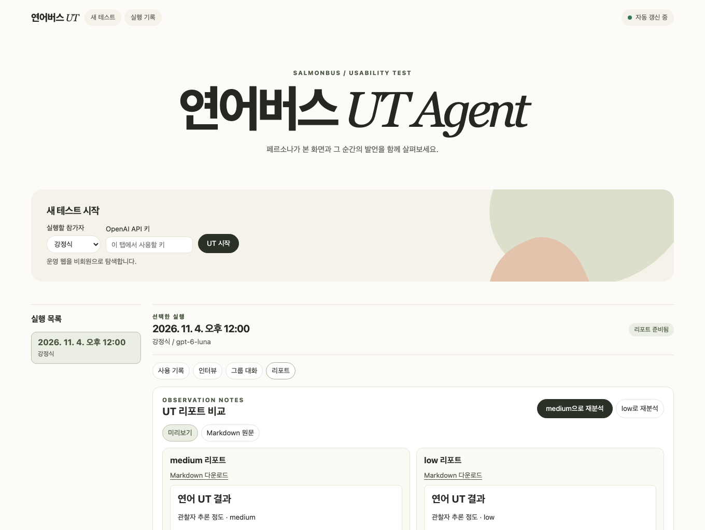

<div align="center">
  <h1>연어버스 UT Agent</h1>
  <p>네 명의 AI 페르소나가 연어를 사용하고, 웹 관찰실에서 화면과 행동을 기록합니다.</p>
  <p>
    <a href="https://salmonbus-ut-agents.vercel.app/"><strong>웹 관찰실 열기</strong></a>
    &nbsp;·&nbsp;
    <a href="https://www.salmonbus.com/">연어 서비스</a>
    &nbsp;·&nbsp;
    <a href="https://github.com/woowacourse-teams/2026-salmonbus">연어 원본 저장소</a>
  </p>
</div>



## 웹에서 사용하기

1. [웹 관찰실](https://salmonbus-ut-agents.vercel.app/)에서 OpenAI API 키를 입력합니다.
2. 참가자 한 명 또는 **전체 참가자**를 선택하고 **UT 시작**을 누릅니다.
3. **사용 기록**에서 행동과 화면을 보고, 종료 후 **인터뷰**에서 추가 질문을 보냅니다.

참가자는 모바일 Chromium에서 연어를 비회원으로 자유 탐색한 뒤, 평소 타는 버스의 도착·좌석 정보를 찾습니다. **그룹 대화**와 **리포트**에서 결과를 보고, 관찰자 기본값인 `medium`을 `low`와 비교할 수 있습니다.

배포에서 만든 기록은 관찰실 주소를 아는 사람이 볼 수 있습니다. 로컬 실행 기록은 각 실행의 `runs/<run-id>/`에 저장됩니다. 모델 호출에는 입력한 API 키의 사용량이 적용됩니다.

## 로컬 실행

Node.js 22.9 이상이 필요합니다.

```sh
git clone https://github.com/bigcloud07/salmonbus-ut-agents.git
cd salmonbus-ut-agents
npm ci
npx playwright install chromium
npm run web
```

[로컬 관찰실](http://127.0.0.1:4310/)에서 API 키를 입력하거나 `.env`의 `OPENAI_API_KEY`를 사용합니다. 테스트는 `npm test`로 실행합니다.

## 참가자

| 참가자 | 직업 | 연어 UT 노선 |
| --- | --- | --- |
| 강정식 (`P1`) | 시스템 소프트웨어 설계 및 분석가 | 9007번 |
| 천상민 (`P2`) | 통계 사무원 | 9300번 |
| 정미란 (`P3`) | 예체능 교사 | 3000번 |
| 김상효 (`P4`) | 무대 및 세트 디자이너 | 1101번 |

NVIDIA의 합성 페르소나 데이터셋에서 원본 네 행을 가져와 [로컬 JSON](data/nemotron-personas-korea.json)에 보관합니다. 원본은 CC BY 4.0이며, 통근 설정은 연어 UT용으로 추가했습니다. [Nemotron-Personas-Korea 원본](https://huggingface.co/datasets/nvidia/Nemotron-Personas-Korea/tree/ada0f5b53a38bb5a30cce09358adde883c1ab63a)
